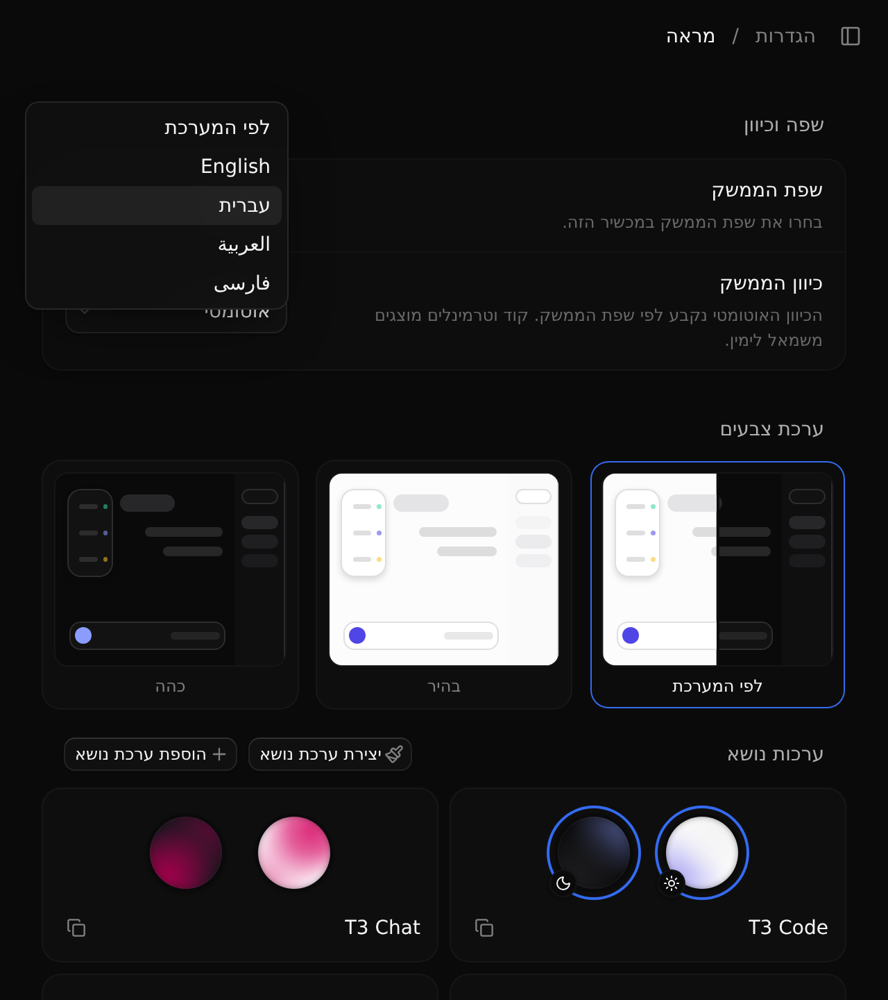
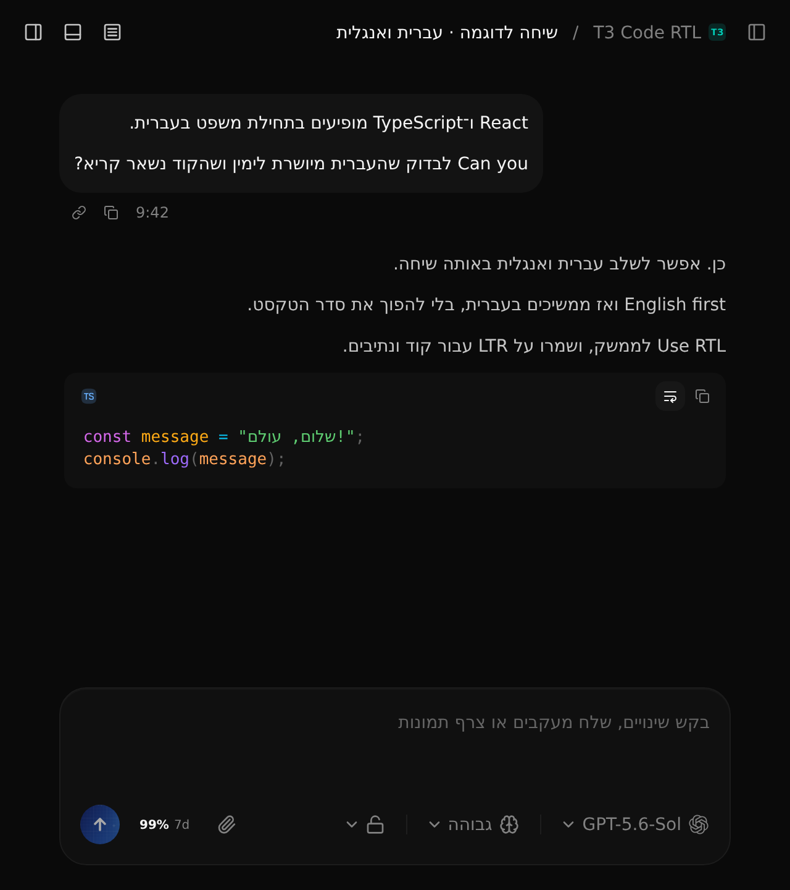

# T3 Code RTL

A community fork of [T3 Code](https://github.com/pingdotgg/t3code) with Hebrew, Arabic, and Persian interface translations and right-to-left layouts. The original T3 Code README is preserved below.

## RTL that follows your text

Hebrew, Arabic, and Persian conversations keep their right-to-left reading direction even when a message starts with an English word. English messages, code, diffs, terminal output, and file paths retain their left-to-right order.

Chat direction uses right-to-left layout when at least 30% of the prose words use a right-to-left script. Inline code does not count toward that threshold. Lists, quote bars, and punctuation follow that direction, while inline code stays isolated. Quoted replies show the excerpt above the reply, and quote controls open after the selected text in its reading direction: on the left for RTL and on the right for LTR.

## What's changed

- **RTL layouts:** Automatic direction based on the selected language, with independent LTR and RTL overrides. Menus, settings, navigation, and controls follow the chosen direction.
- **Interface languages:** English, Hebrew, Arabic, Persian, and upstream's additional language choices, or the device's system language. Language and direction preferences are saved per device or browser.
- **Readable code and terminals:** Code, diffs, terminal output, paths, and filenames keep their left-to-right reading order inside an RTL interface.
- **Translations across the clients:** Shared translation catalogs for web, desktop, and mobile, including settings, command labels, shortcuts, model options, dialogs, and notifications. User messages and project names retain their original content.
- **Display fixes:** Mixed-language text, inline file links, font previews, diff previews, and terminal previews work within RTL layouts. Dates and relative times use the interface language.
- **Small usage meters:** The web and desktop composer shows the selected account's reported `5h` and `7d` limits in the existing space below the input, with progress bars, used percentages, and reset countdowns. Usage above 80% turns red. Click for all reported limits and to use a reset credit when available, after confirmation.
- **Updates from upstream:** Web RTL styles are generated at build time with RTLCSS. The original visual identity is retained with a small RTL label.

New installations follow the browser or device language by default. Choose a language on the welcome screen or under **Settings → Appearance → Interface language**. **Interface direction** can follow the language automatically or be set separately.

Arabic and Persian include machine-assisted translations with terminology corrections; contributions from native speakers are welcome.

## Hebrew preview

Screenshots from two 640 × 720 windows. The sample conversation includes Hebrew sentences that start with English words, alongside left-to-right code.

<table>
  <tr>
    <th width="50%">Hebrew interface</th>
    <th width="50%">Hebrew and English conversation</th>
  </tr>
  <tr>
    <td><a href="docs/images/rtl-interface-he.png"></a></td>
    <td><a href="docs/images/rtl-chat-he.png"></a></td>
  </tr>
</table>

## Downloads

For most users, **install the desktop app** from [GitHub Releases](https://github.com/ttv20/t3code/releases/latest): use the **`.exe` installer on Windows**, **`.dmg` on macOS**, or **`.AppImage` on Linux**.

The releases also include:

- **Windows x64:** desktop installer (`.exe`), standalone CLI (`.zip`), and an npm-installable package.
- **macOS:** disk images (`.dmg`) for Apple Silicon and Intel, uploaded when their builds finish. These builds are unsigned and not notarized.
- **Linux x64:** desktop packages (`.AppImage` and `.deb`) and a standalone CLI archive.
- **Android ARM64:** a signed, standalone `.apk`, uploaded when its build finishes. It installs alongside upstream T3 Code and connects to your T3 server.
- **npm / Bun:** self-contained `.tgz` packages with the server and web UI for Windows x64 and Linux x64. Linux also supports `bun add --global`.

Use the release notes to check which changes are included in each build.

### Install with npm

For the CLI and local web app, install this fork directly from its latest release.

Windows x64, in PowerShell:

```powershell
npm install --global https://github.com/ttv20/t3code/releases/latest/download/t3-win32-x64.tgz
t3
```

Linux x64:

```bash
npm install --global https://github.com/ttv20/t3code/releases/latest/download/t3-linux-x64.tgz
t3
```

These commands use this fork's release assets. The upstream `npm install --global t3` command installs the original project.

## Run from source

From a clone of this repository, with [Vite+](https://vite.plus) installed:

```bash
vp i
vp run dev
```

The installation links and package names in the original README below refer to upstream T3 Code. Use the fork downloads, npm commands, or source checkout above for the RTL build.

---

> [!NOTE]
> Original project README

# T3 Code

<p align="center">
  <a href="https://t3.codes">
    
  </a>
</p>

<h1 align="center">T3 Code</h1>

<p align="center">The open-source control plane for coding agents.</p>

<p align="center">
  <a href="https://t3.codes/download"><strong>Download</strong></a> ·
  <a href="https://apps.apple.com/us/app/t3-code-remote-claude-more/id6787819824">iOS</a> ·
  <a href="https://play.google.com/store/apps/details?id=com.t3tools.t3code">Android</a> ·
  <a href="https://app.t3.codes">Web</a> ·
  <a href="./docs/README.md">Docs</a> ·
  <a href="https://discord.gg/jn4EGJjrvv">Discord</a>
</p>

<p align="center">
  <a href="https://t3.codes">
    
  </a>
</p>

T3 Code runs the coding agents on your machine and gives them one fast interface. Start a thread at your desk, then approve the next step from your phone.

It works with Claude Code, Codex, Cursor, OpenCode, Grok Build, Antigravity, Kiro, Pi, Muse Code, fx, and any [ACP](./docs/user/providers-acp.md) agent. If an agent is set up on your computer, T3 Code can control it.

## What you get

- **Your subscriptions.** T3 Code does not resell tokens. It drives the agents you are already signed in to.
- **Every agent in one place.** Change models in the middle of a thread. Let Claude hand a task to Codex.
- **Desktop, web, and phone.** One server, and every client shows the same threads. There are apps for iOS and Android.
- **Remote ready.** Run agents on any machine. Connect over your local network, Tailscale, or [T3 Connect](./docs/user/remote-access.md).
- **Git built in.** Each thread can work in its own worktree. Review the diff, then commit, push, and open a pull request with one button.
- **Fast.** Performance is a feature here. We measure it, and we treat a dropped frame as a bug.
- **Open.** Source code is MIT licensed. If you don't like something, fork it under your own branding (see [Trademarks and forks](#trademarks-and-forks)).

## Install

### Desktop app

[Download T3 Code](https://t3.codes/download) for macOS, Windows, or Linux. You can also use a package manager:

| Platform       | Command                                                              |
| -------------- | -------------------------------------------------------------------- |
| macOS          | `brew install --cask t3-code`                                        |
| Windows        | `winget install T3Tools.T3Code` or `scoop install extras/t3code`     |
| Arch Linux     | `yay -S t3code-bin`                                                  |
| Nix            | `nix profile add github:NixOS/nixpkgs/nixos-unstable#t3code`         |
| Debian, Ubuntu | `.deb` from [Releases](https://github.com/pingdotgg/t3code/releases) |

### Command line

This installs the `t3` command. Run `t3` to start the server and open the web app.

```bash
curl -fsSL https://t3.codes/install.sh | sh
```

On Windows, in PowerShell:

```powershell
irm https://t3.codes/install.ps1 | iex
```

To try it once without an install, run `npx t3@latest`.

### Phone

Get the app from the [App Store](https://apps.apple.com/us/app/t3-code-remote-claude-more/id6787819824) or [Google Play](https://play.google.com/store/apps/details?id=com.t3tools.t3code). Then follow [remote access](./docs/user/remote-access.md) to connect it to your computer.

### Sign in to an agent

T3 Code needs one agent that is installed and signed in. For example, install [Claude Code](https://claude.com/product/claude-code) and run `claude auth login`, or install [Codex CLI](https://developers.openai.com/codex/cli) and run `codex login`.

[Provider setup](./docs/user/install.md#providers) has the steps for each agent. [Install T3 Code](./docs/user/install.md) covers nightly builds, AppImage, WSL, and NixOS.

## "Wait, what are you selling me?"

Nothing. We built T3 Code because we wanted the best possible development experience with agents. We were inspired by existing solutions like the Codex desktop app, Conductor, Claude Desktop and Cursor Glass, but none met our bar.

We wanted something performant, remote-ready, and truly open. If we ever go the wrong direction, we want you to have everything you need to fork the source code and build the tool that you want, under your own name and branding.

## Documentation

- [Install and first run](./docs/user/install.md)
- [Remote access from a phone or another machine](./docs/user/remote-access.md)
- [Permission modes](./docs/user/permission-modes.md)
- [Source control](./docs/user/source-control.md)
- [Connect outside agents over MCP](./docs/user/outside-agents.md)
- [FAQ](./docs/user/faq.md)

[All docs](./docs/README.md) has the full list.

## Contributing

We have limited review capacity. Small, focused fixes are the most likely to be merged. Features need an approved discussion first.

- Read [CONTRIBUTING.md](./CONTRIBUTING.md) before you report a bug or open a pull request.
- Put feature requests in [Ideas](https://github.com/pingdotgg/t3code/discussions/categories/ideas).
- Build from source with the [development runbook](./docs/operations/00_development.md#first-checkout). The [architecture overview](./docs/internals/01_architecture.md) explains how it works.
- Get help in [Discord](https://discord.gg/jn4EGJjrvv).

## License

The source code in this repository is licensed under the [MIT License](./LICENSE).

## Trademarks and forks

The MIT license applies **only to the source code**. It does not grant any rights to T3 Tools, Inc.'s trademarks, branding, or trade dress, including the **T3 Code** name, wordmark, logos, and application icons.

If you fork, redistribute, or build on T3 Code's source code:

- **Use your own branding.** Replace the T3 Code name, wordmark, logos, and application icons in any public fork, redistributed build, website, package, or app store listing.
- **Be explicitly clear that your project is unofficial.** Do not use the T3 Code name, wordmark, logo, or branding in your own projects without making it unmistakably clear that your project is unofficial and not affiliated with or endorsed by T3 Tools, Inc.

Using our name, wordmark, logo, or branding in a way that suggests official status or affiliation is trademark infringement and unlawful. **Any project indicating or implying that it is an official version of T3 Code when it is not will be pursued to the full extent of the law.**

See [TRADEMARK.md](./TRADEMARK.md) for the full trademark and branding policy.
