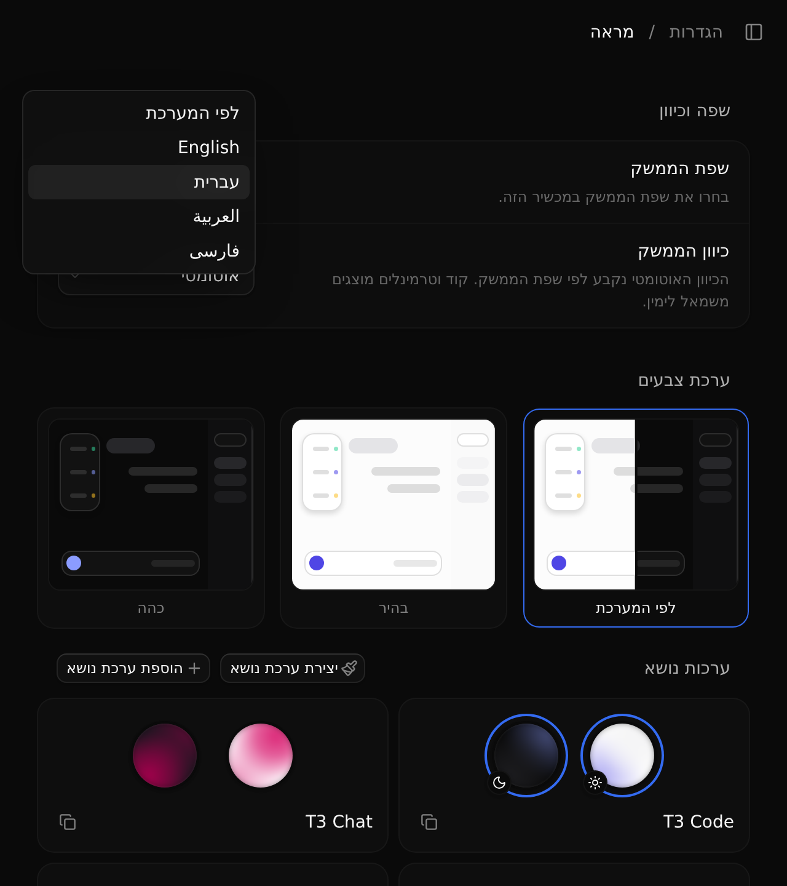
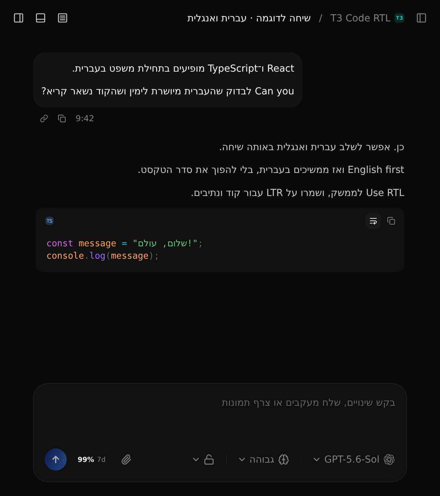

# T3 Code RTL

A community fork of [T3 Code](https://github.com/pingdotgg/t3code) with Hebrew, Arabic, and Persian interface translations and right-to-left layouts. The original T3 Code README is preserved below.

## What's changed

- **Interface languages:** English, Hebrew, Arabic, Persian, or the device's system language. Language and direction preferences are saved per device or browser.
- **RTL layouts:** Automatic direction based on the selected language, with independent LTR and RTL overrides. Menus, settings, navigation, and controls follow the chosen direction.
- **Readable code and terminals:** Code, diffs, terminal output, paths, and filenames keep their left-to-right reading order inside an RTL interface.
- **Translations across the clients:** Shared translation catalogs for web, desktop, and mobile, including settings, command labels, shortcuts, model options, dialogs, and notifications. User messages and project names retain their original content.
- **Display fixes:** Mixed-language text, inline file links, font previews, diff previews, and terminal previews work within RTL layouts. Dates and relative times use the interface language.
- **Updates from upstream:** Web RTL styles are generated at build time with RTLCSS. The original visual identity is retained with a small RTL label.

New installations follow the browser or device language by default. Choose a language on the welcome screen or under **Settings → Appearance → Interface language**. **Interface direction** can follow the language automatically or be set separately.

Arabic and Persian include machine-assisted translations with terminology corrections; contributions from native speakers are welcome.

## Hebrew preview

Screenshots from two 640 × 720 windows. The sample conversation includes Hebrew sentences that start with English words, alongside left-to-right code.

<table>
  <tr>
    <th width="50%">Hebrew interface</th>
    <th width="50%">Hebrew and English conversation</th>
  </tr>
  <tr>
    <td><a href="docs/images/rtl-interface-he.png"></a></td>
    <td><a href="docs/images/rtl-chat-he.png"></a></td>
  </tr>
</table>

## Downloads

[GitHub Releases](https://github.com/ttv20/t3code/releases) includes:

- **Windows x64:** desktop installer (`.exe`).
- **Linux x64:** desktop packages (`.AppImage` and `.deb`) and a standalone CLI archive.
- **npm / Bun:** a self-contained `.tgz` package with the server and web UI. Download the package from the release and pass its local path to `npm install --global` or `bun add --global`.

Use the release notes to check which changes are included in each build.

## Run this fork

From a clone of this repository, with [Vite+](https://vite.plus) installed:

```bash
vp i
vp run dev
```

The installation links and published packages in the original README below install upstream T3 Code. Use this checkout to run the RTL changes.

---

# T3 Code

T3 Code is an "agent harness control surface". It enables control of the agents on your machine with a best-in-class mobile app ([iOS](https://apps.apple.com/us/app/t3-code-remote-claude-more/id6787819824), [Android](https://play.google.com/store/apps/details?id=com.t3tools.t3code)), [web app](https://app.t3.codes) and [Electron-based desktop app](https://t3.codes).

Works with your subscriptions on Claude Code, Codex, Cursor, Grok Build, OpenCode, and Google Antigravity. If they're set up on your computer, T3 Code can control them.

## "Wait, what are you selling me?"

Nothing. We built T3 Code because we wanted the best possible development experience with agents. We were inspired by existing solutions like the Codex desktop app, Conductor, Claude Desktop and Cursor Glass, but none met our bar.

We wanted something performant, remote-ready, and truly open. If we ever go the wrong direction, we want you to have everything you need to fork and build the editor that you want.

## Installation

> [!WARNING]
> T3 Code currently supports Codex, Claude, Cursor, Grok Build, OpenCode, and Antigravity. Install and authenticate at least one provider before use:
>
> - Codex: install [Codex CLI](https://developers.openai.com/codex/cli) and run `codex login`
> - Claude: install [Claude Code](https://claude.com/product/claude-code) and run `claude auth login`
> - Cursor: install [Cursor CLI](https://cursor.com/cli) and run `agent login`
> - Grok Build: install [Grok Build CLI](https://x.ai/cli) and run `grok login`
> - OpenCode: install [OpenCode](https://opencode.ai) and run `opencode auth login`
> - Antigravity: enable it in Settings, then use **Install Antigravity** and **Sign in with Google**. No CLI is required.

### Command line

```bash
curl -fsSL https://t3.codes/install.sh | sh
```

On Windows, in PowerShell:

```powershell
irm https://t3.codes/install.ps1 | iex
```

Then run `t3` to start the server and open the local web app. `t3 service install` keeps it running in the background, `t3 update` moves to a newer release, and `t3 --help` has the full reference.

To try it once without installing, run `npx t3@latest` instead.

### Desktop app

Install the latest version of the desktop app from [GitHub Releases](https://github.com/pingdotgg/t3code/releases), or from your favorite package registry:

#### Windows (`winget`)

```bash
winget install T3Tools.T3Code
```

#### Windows (`scoop`)

```bash
scoop install extras/t3code
```

#### macOS (Homebrew)

```bash
brew install --cask t3-code
```

#### Debian, Ubuntu (`.deb`)

Download the `.deb` from [GitHub Releases](https://github.com/pingdotgg/t3code/releases), then:

```bash
sudo apt install ./T3-Code-*.deb
```

#### Arch Linux (AUR)

Stable:

```bash
yay -S t3code-bin
```

Nightly:

```bash
yay -S t3code-nightly-bin
```

The AUR packaging is maintained in this repository under [`packaging/aur`](./packaging/aur).

## Some notes

We are very very early in this project. Expect bugs.

We are (mostly) not accepting contributions yet. Small fixes may be considered. Big features will not be.

## Documentation

Full docs live in [docs/](./docs). There's no docs site yet.

- [Install and first run](./docs/user/install.md)
- [Permission modes](./docs/user/permission-modes.md)
- [Keyboard shortcuts](./docs/user/keybindings.md)
- [Project settings](./docs/user/project-settings.md)
- [Appearance preferences](./docs/user/appearance.md)
- [Remote access from a phone or another machine](./docs/user/remote-access.md)
- [Connect Claude Code, Codex, ChatGPT and other agents over MCP](./docs/user/outside-agents.md)
- [Keeping app and server in sync](./docs/user/updating.md)
- [Source control integrations](./docs/user/source-control.md)
- Multiple accounts: [Codex](./docs/user/providers-codex.md) · [Claude](./docs/user/providers-claude.md)
- [Run T3 Code as a background service](./docs/user/background-service.md)

Building from source? Start at [docs/internals/overview.md](./docs/internals/overview.md).

## If you REALLY want to contribute still.... read this first

### Install `vp`

T3 Code uses Vite+ so you'll need to install the global `vp` command-line tool.

#### macOS / Linux

```bash
curl -fsSL https://vite.plus | bash
```

#### Windows

```bash
irm https://vite.plus/ps1 | iex
```

Checkout their getting started guide for more information: https://viteplus.dev/guide/

### Install dependencies

```bash
vp i
```

Read [CONTRIBUTING.md](./CONTRIBUTING.md) before reporting a bug or opening a PR.

Have a feature request? Start an [Ideas discussion](https://github.com/pingdotgg/t3code/discussions/categories/ideas).

Need support? Join the [Discord](https://discord.gg/jn4EGJjrvv).
